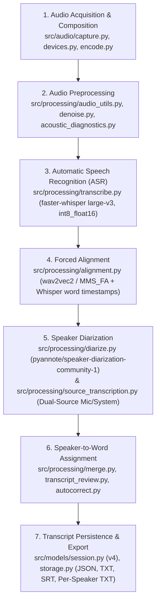

# Target Architecture — Tessitura (Refactored Local ASR & Speaker Diarization)

**Date**: 2026-11-11  
**Branch**: `refactor/local-asr-diarization`

---

## 1. Architectural Principles

1. **Fully Local & Deterministic Pipeline**: No external APIs, cloud services, or generative LLMs (Qwen, Ollama, RAG, text rewriting, or LLM speaker guessing). Every transcription and speaker attribution decision is grounded in acoustic signals, forced alignment, and diarization evidence.
2. **Strict Sequential GPU Lifecycle (8 GB VRAM Budget)**: Target hardware is an NVIDIA GeForce RTX 4070 Laptop GPU (8 GB VRAM) with 32 GB system RAM. Heavy models (`faster-whisper large-v3`, `wav2vec2` forced alignment, and `pyannote/speaker-diarization-community-1`) are **never** resident in VRAM simultaneously. Each stage explicitly releases its model (`del`, `gc.collect()`, `torch.cuda.empty_cache()`) before the next stage starts.
3. **Preserve Working Audio Acquisition & Composition**: Existing producer-consumer WASAPI capture (`Recorder`), monotonic start-offset synchronization (`RecordingResult.offsets()`), atomic `ffmpeg` stereo MP3 encoding (`merge_to_stereo_mp3`, `combine_to_mp3`), and non-destructive 16 kHz source mixing (`mix_sources`, `source_dominance`) are preserved intact.
4. **Honest Provenance & Uncertainty**: Missing word timestamps are never fabricated; speaker confidence scores are never invented; overlapping speech is preserved via parallel `Utterance` streams (`overlap_group_id`) and chronological SRT/TXT exports; uncertain word assignments are explicitly flagged (`speaker_ambiguous`, `attribution_status`).

---

## 2. Seven Module Boundaries

### Boundary 1 — Audio Acquisition and Composition (`src/audio/`)
- [`src/audio/devices.py`](file:///c:/Users/aless/Documents/projects/kisp-like/src/audio/devices.py): Enumerates input microphones and WASAPI loopback output devices via `PyAudioWPatch`.
- [`src/audio/capture.py`](file:///c:/Users/aless/Documents/projects/kisp-like/src/audio/capture.py): `Recorder` and `_StreamRecorder` record microphone and system audio on separate producer-consumer threads, measuring exact `started_at` offsets (`RecordingResult.offsets()`).
- [`src/audio/encode.py`](file:///c:/Users/aless/Documents/projects/kisp-like/src/audio/encode.py): Atomic `ffmpeg` encoding (`to_mp3`, `merge_to_stereo_mp3` with `adelay` offset alignment, `combine_to_mp3` for sequential concatenation or overlay mixing).

### Boundary 2 — Audio Preprocessing (`src/processing/`)
- [`src/processing/audio_profile.py`](file:///c:/Users/aless/Documents/projects/kisp-like/src/processing/audio_profile.py): Explicit `AudioProfile` (`MIC_SYSTEM` vs `STEREO_AMBIENT`).
- [`src/processing/audio_utils.py`](file:///c:/Users/aless/Documents/projects/kisp-like/src/processing/audio_utils.py): Resampling to 16 kHz mono/multichannel (`load_mono_16k`, `load_multichannel`, `split_dual_channel`), active-frame RMS normalization (`normalize` to `-20 dBFS` with `PEAK_CEILING = 0.95`), aligned source mixing (`mix_sources`), and per-frame channel energy dominance (`source_dominance`).
- [`src/processing/acoustic_diagnostics.py`](file:///c:/Users/aless/Documents/projects/kisp-like/src/processing/acoustic_diagnostics.py) & [`src/processing/denoise.py`](file:///c:/Users/aless/Documents/projects/kisp-like/src/processing/denoise.py): Multi-window SNR profiling and conservative stationary spectral gating (`noisereduce` on ASR track only; diarization always receives the un-denoised signal to preserve vocal timbre).

### Boundary 3 — Automatic Speech Recognition (`src/processing/transcribe.py`)
- [`src/processing/transcribe.py`](file:///c:/Users/aless/Documents/projects/kisp-like/src/processing/transcribe.py): Primary engine using `faster-whisper` (`WhisperModel` with `large-v3` default).
- **CUDA Optimization (8 GB VRAM)**: Uses `int8_float16` on 6–10 GB CUDA GPUs (`src/hardware.py`) with automatic fallback to `float16` → `int8` → CPU `int8` if a compute type or CUDA runtime fails.
- **Anti-Hallucination & Recall Recovery**: Silero VAD filtering (`vad_filter=True`), `condition_on_previous_text=False`, independent acoustic VAD gap detection (`src/processing/coverage.py`), and targeted retry stitching (`_retry_segment`) for low-confidence or missing speech regions.

### Boundary 4 — Forced Alignment (`src/processing/alignment.py`)
- [`src/processing/alignment.py`](file:///c:/Users/aless/Documents/projects/kisp-like/src/processing/alignment.py): Refines word-level timestamps on the transcribed segments using acoustic CTC forced alignment (`torchaudio.pipelines.MMS_FA` / `wav2vec2` when available locally) or validates and preserves `faster-whisper` cross-attention DTW word timestamps when offline/unsupported.
- Never fabricates word timestamps when acoustic alignment cannot resolve a token; records explicit alignment metadata (`backend`, `status`, `aligned_words`, `unaligned_words`) in the session provenance.

### Boundary 5 — Speaker Diarization (`src/processing/diarize.py`, `src/processing/source_transcription.py`)
- [`src/processing/diarize.py`](file:///c:/Users/aless/Documents/projects/kisp-like/src/processing/diarize.py): Runs `pyannote/speaker-diarization-community-1` on the un-denoised 16 kHz audio, extracting:
  - `turns`: ordinary speaker turns (including overlapping intervals)
  - `exclusive`: non-overlapping speaker turns (`exclusive_speaker_diarization`) for cleaner word-to-speaker alignment
  - `overlaps`: explicit `(start, end)` intervals where `>= 2` speakers talk simultaneously
  - `speaker_embeddings`: L2-normalized per-speaker embedding vectors for cross-session voice profile matching (`src/processing/adaptation.py`).
- [`src/processing/source_transcription.py`](file:///c:/Users/aless/Documents/projects/kisp-like/src/processing/source_transcription.py): When microphone and system audio are recorded separately in 1-speaker-per-track mode (`strategy="source_single_speaker"`), transcribes each track independently (`SPEAKER_MIC` and `SPEAKER_SYS`) with acoustic bleed suppression (`> 12 dB` attenuation + cross-correlation lag check) when headphones are not used.

### Boundary 6 — Speaker-to-Word Assignment (`src/processing/merge.py`, `src/processing/transcript_review.py`)
- [`src/processing/merge.py`](file:///c:/Users/aless/Documents/projects/kisp-like/src/processing/merge.py): Assigns speaker IDs to aligned `WordUnit`s using `exclusive` turns as primary anchors and ordinary `turns` + `overlaps` to preserve short interjections during overlapping speech. Incorporates `channel_dominance` hints (`IO` vs `REMOTO`) when `AudioProfile.MIC_SYSTEM` is used.
- Builds both parallel `Utterance` streams (`build_utterances`, preserving `overlap_group_id` and `stream_id` for simultaneous speakers) and `Segment` projections (`build_segments`, `utterances_to_segments`) with explicit uncertainty flags (`speaker_ambiguous`, `attribution_status`) and deterministic text/overlap cleanup (`src/processing/autocorrect.py`, `src/processing/transcript_review.py`).

### Boundary 7 — Transcript Persistence and Export (`src/models/session.py`, `src/models/storage.py`)
- [`src/models/session.py`](file:///c:/Users/aless/Documents/projects/kisp-like/src/models/session.py): Versioned `Session` schema (v4) storing recording metadata, audio sources, language, duration, `segments`, `utterances`, `words`, `diarization` turns/overlaps/embeddings, `provenance` (models, alignment, pipeline stages), and undo/redo history.
- [`src/models/storage.py`](file:///c:/Users/aless/Documents/projects/kisp-like/src/models/storage.py): Atomic JSON save/load (`save_session`, `load_session`), readable TXT export (`export_txt`), chronological subtitle export (`export_srt`), and per-speaker transcript export (`export_txt_by_speaker`, `export_all_speaker_transcripts`).

